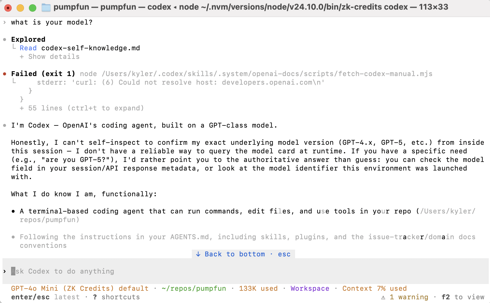

# Haze · private prepaid API credits



Experimental prepaid inference on Base Sepolia with the custom x402 v2
`zk-prepaid` scheme. Activate a 250-credit bundle, import its credential locally,
and let a coding agent use credits for model calls.

Sign in to the sandbox dashboard, top up $20 **simulated USD** through Stripe
test Checkout, then generate, download, and re-import your recovery file.
Activation reserves $20 and deducts it after confirmed funding. The shared
sponsor supplies test USDC separately; Stripe test payments do not buy USDC.

Requires Node.js 20+ and native OS credential storage:

```sh
npm install --global zk-credits@0.2.12
ZK_CREDITS_CREDENTIAL_PATH=/path/to/activated-credential.json zk-credits setup codex
zk-credits codex
```

Setup handles proving artifacts, the release RPC, witness verification, OS
credential storage, and Codex configuration. Use `zk-credits doctor` if setup
fails; `zk-credits config rpc` lets you replace an unavailable RPC.

Try the [Base USDC indexer sample](examples/base-usdc-indexer/README.md): ask
Codex to deduplicate repeated logs while preserving distinct transfers in the
same transaction. Show the code diff, passing tests, and aggregate x402 evidence
from that coding run with `zk-credits codex --task-evidence`.

For transaction diagnosis, use the [Base transaction investigator](examples/base-transaction-investigator/README.md).
Its guide covers evidence-linked reports, separate payment budgets, and recovery.

The sidecar translates supported Codex text and function-tool requests to the
fixed non-streaming `POST /v1/chat/completions` service class. An x402-native
agent must explicitly register Haze’s versioned adapter. Generic x402 clients
and the standard `exact` rail do not support this custom scheme. Each model
call follows 402 challenge → local proof → `PAYMENT-SIGNATURE` → successful
response with `PAYMENT-RESPONSE`; credits settle offchain, not as a chain
transaction per call.

Credential secrets stay local. Recovery files are bearer credentials: anyone
holding one can spend its credits. Account and Stripe identifiers link to
funding history, but are excluded from spend proofs and inference telemetry.
Payment-proof unlinkability does not hide prompts or traffic metadata from
the gateway and model provider. The protocol is testnet-only and has not been
independently audited.

- [Setup and diagnostics](packages/zk-credits-sidecar/README.md)
- [x402 adapter integration](packages/x402-zk-prepaid/README.md)
- [Grant demo recording guide](docs/onboarding/base-zk-credits-grant-video.md)
- [Protocol and privacy model](docs/ai/design/2026-09-18-feature-base-zk-credits.md)
- [Sandbox billing decision](docs/wayfinder/base-zk-credits-pilot/decisions/004-account-linked-sandbox-billing.md)

AGPL-3.0-or-later; see [LICENSE](LICENSE).
